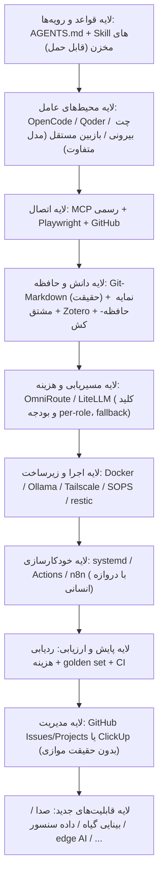

# گزارش پژوهش زیرساخت فناورانه پروژه G&G^SMART

> **جایگاه این سند:** گزارش پژوهشی دربارهٔ فرصت‌های ارتقای **زیرساخت و توانمندی کل پروژه** با ابزارها و فناوری‌های روز.
> مکمل [[زیرساخت هوش مصنوعی و مغز پروژه]] (طرح کلان پیشنهادی) است؛ جایگزین آن یا سایر اسناد مرجع نیست.
> **اصل حاکم:** این سند به‌تنهایی مجوز نصب، خرید، تغییر تنظیمات یا تغییر گردش‌کار رسمی نیست.
> **بدون اولویت‌بندی قطعی:** گزینه‌ها، مزایا، محدودیت‌ها و جایگزین‌ها مستند شده‌اند تا تصمیم دربارهٔ اهمیت و مسیر سرمایه‌گذاری با مدیر پروژه باشد.
> **تاریخ پژوهش:** 2026-11-14 — تصویر فناوری در این تاریخ؛ بازار به‌سرعت تغییر می‌کند (نمونه‌ها در بخش ۸).

## ۱. هدف و تغییر جهت پژوهش

پژوهش قبلی بیش از حد بر مهندسی و اجرای طرح فیزیکی جاری متمرکز بود. جهت اصلاح‌شده:

- **طرح فیزیکی جاری فقط یکی از مصادیق و خروجی‌های پروژه است**، نه تعریف پروژه. موضوع پژوهش، توانمندی کلی G&G^SMART برای تحقیق، خلاقیت، طراحی، توسعه، مدیریت و اجرا در حوزه‌های مختلف است.
- محور کشف، **ارتقای خودِ زیرساخت پروژه** است: هوش مصنوعی و عامل‌ها، همکاری چندمدلی، اتصال به فایل/مخزن/نرم‌افزار/سرویس، Skill/MCP/Plugin، خودکارسازی، حافظه و دانش، تحقیق علمی، محیط توسعه، زیرساخت محلی/ابری/ترکیبی، مدیریت و هماهنگی عامل‌ها، تولید محتوا و تصمیم‌سازی، ارزیابی کیفیت خروجی AI، یکپارچه‌سازی، و فناوری‌های ایجادکنندهٔ قابلیت‌ها و حوزه‌های تازه.
- ابزارها بر اساس **ارزش برای کل پروژه** ارزیابی شده‌اند: زیرساختی که هم‌زمان چند حوزه را تقویت کند («فرابخشی») از ابزار تخصصی یک قطعه متمایز شده است. این تمایز در تحلیل لحاظ شده، اما به رتبه‌بندی یا اولویت قطعی تبدیل نشده است.
- ابزارهای تخصصی حوزهٔ فعلی (KiCad، FreeCAD، ESPHome، Home Assistant و مشابه) فقط در بخش ۶ و در حاشیه آمده‌اند؛ محور گزارش نیستند.

## ۲. روش پژوهش و سطح اعتبار

- پژوهش وب در ۲۰۲۶-۱۱-۱۴ در پنج خوشهٔ موازی انجام شد: (۱) عامل‌ها و محیط‌های اجرا و همکاری چندمدلی، (۲) اتصال‌ها و اکوسیستم Skill/MCP/Plugin و یکپارچه‌سازی، (۳) دانش/حافظه/بازیابی و تحقیق علمی، (۴) زیرساخت محلی/ابری/ترکیبی و خودکارسازی، (۵) مدیریت/ارزیابی/محتوا/حوزه‌های جدید.
- منابع ترجیحی: مستندات و وبلاگ‌های رسمی سازندگان؛ سپس منابع ثانویهٔ معتبر. مواردی که فقط از منبع ثانویه گزارش شده‌اند با نشان **[تأییدنشده]** مشخص شده‌اند (فهرست در پیوست).
- سه سطح اعتبار در سراسر گزارش: **تأییدشده** (منبع اولیه)، **گزارش ثانویه** (نیازمند راستی‌آزمایی پیش از تصمیم)، **نیازمند آزمون** (به‌ویژه کیفیت فارسی: embedding، داوری LLM، صدا، RTL).
- این گزارش «ممیزی فاز صفر» سند طرح کلان نیست؛ فقط مشاهدهٔ فقط‌خواندنی محدودی از وضع موجود (بخش ۳) برای واقع‌گرا کردن تحلیل انجام شده است.

## ۳. وضع موجود زیرساخت (مشاهدهٔ فقط‌خواندنی، 2026-11-14)

**موجود و فعال:**
- مخزن واحد `hldvd/GG-SMART` با اسناد فارسی Markdown به‌عنوان منبع حقیقت؛ پشتیبان‌گیری خودکار Git (`gg-backup`، کامیت‌های cron).
- OpenCode با مدل از مسیر OmniRoute؛ دو MCP راه‌دور فعال: `clickup` و `scite`؛ در پیکربندی بررسی‌شده plugin تعریف‌شده‌ای دیده نشد.
- Qoder Desktop (محیط جاری) با امکانات Skill/Plugin/MCP/Agent تیمی و Repo Wiki.
- VS Code و Cursor نصب؛ Obsidian روی مخزن (پوشهٔ `.obsidian` ردیابی‌شده)؛ Docker، Git، gh، Python/uv، Node نصب.
- Ollama نصب اما **بدون هیچ مدل دانلودشده**.

**واقعیت سخت‌افزاری دستگاه جاری (مشاهده‌شده):**
- لپ‌تاپ قدیمی: GPU از نوع GeForce 310M (برای LLM امروزی عملاً بی‌استفاده)، **RAM کل ۵٫۸ گیگابایت** (در لحظهٔ بررسی ~۱٫۴ گیگابایت آزاد)، ۸ رشتهٔ CPU، ~۳۸ گیگابایت فضای خالی دیسک.
- پیامد: اجرای مدل زبانی محلی حتی در کلاس ۳–۸B روی **این دستگاه** عملاً ممکن نیست؛ سرویس‌های self-host سنگین (مثل پشتهٔ کامل Langfuse یا RAGFlow با حداقل ۱۶ گیگابایت RAM) نیز روی این دستگاه محدودیت جدی دارند. گزینه‌های محلی/ترکیبی یا به سخت‌افزار دیگری نیاز دارند یا به سرویس ابری/اجارهٔ GPU. (آیا دستگاه/سرور دیگری در اختیار پروژه است؟ از منابع پروژه مشخص نیست؛ نیازمند اعلام مدیر.)

**شکاف‌های مشاهده‌شده نسبت به ظرفیت‌های ممکن (بدون قضاوت اولویت):**
- کتابخانهٔ Skill/رویهٔ نسخه‌بندی‌شده در مخزن وجود ندارد؛ قواعد نقش‌ها در AGENTS.md است اما تفکیک مکانیکی نقش‌ها (agent سفارشی با دسترسی و مدل متفاوت) در پیکربندی OpenCode دیده نشد.
- هیچ سامانهٔ ارزیابی (golden set / eval)، ردیابی هزینه/توکن، یا پایش کیفیت خروجی عامل‌ها مشاهده نشد.
- سابقهٔ نشت کلید API در تاریخچهٔ مخزن وجود دارد (کامیت «Untrack cli-rest-mcp data.json (contains API key)»)؛ مدیریت متمرکز کلید/بودجه مشاهده نشد.
- بازیابی دانش فعلاً فایل‌محور است (grep/ساختار/Git)؛ نمایهٔ معنایی/برداری وجود ندارد (این لزوماً شکاف نیست؛ بخش ۵٫۶).

## ۴. چارچوب ارزیابی (معیار، نه رتبه‌بندی)

هر گزینه در این گزارش با این معیارها توصیف شده است؛ وزن‌دهی و تصمیم با مدیر پروژه:

1. **گستردگی اثر:** فرابخشی (پژوهش+طراحی+توسعه+مدیریت+مستندسازی هم‌زمان) یا تخصصی/مشروط.
2. **بلوغ و پایداری:** وضعیت پروژه/فروشنده در ۲۰۲۶ (فعال، راکد، منتقل‌شده، تعطیل) — بازار امسال پرتلاطم بوده است.
3. **هزینهٔ کل:** پول (اشتراک/API/سخت‌افزار) + زمان نگهداری برای یک نفر.
4. **حریم خصوصی و امنیت:** مسیر داده، حداقل دسترسی، سابقهٔ رخدادهای امنیتی.
5. **پشتیبانی فارسی:** کیفیت embedding/داوری/صدا/RTL — اغلب **نیازمند آزمون**، نه فرض.
6. **قابلیت حمل و استاندارد باز:** سرمایه‌گذاری روی پروتکل‌های باز (MCP/Skills/AGENTS.md) در برابر قفل فروشنده.
7. **برگشت‌پذیری و حداقل‌گرایی:** امکان حذف/جایگزینی آسان؛ نصب فقط برای شکاف اثبات‌شده (اصل سند طرح کلان).
8. **سازگاری با معماری پروژه:** پنج نقش، تصمیم نهایی انسان، Git-Markdown به‌عنوان تنها منبع حقیقت، عدم ایجاد حقیقت موازی.

## ۵. حوزه‌های زیرساختی

### ۵٫۱ هوش مصنوعی و عامل‌های خودمختار

**فرصت:** عامل‌های CLI/دسکتاپ امروزی فراتر از تکمیل کد هستند: زیرعامل موازی، Skill، hook، MCP، وظایف پس‌زمینه و زمان‌بندی. برای پروژه‌ای با پنج نقش، این ابزارها امکان **تفکیک مکانیکی نقش‌ها** (مدل متفاوت، دسترسی متفاوت، محیط جدا) و اجرای موازی مأموریت‌ها با دروازهٔ انسانی را می‌دهند.

| گزینه | وضعیت و مدل هزینه (۲۰۲۶) | مزایا برای G&G^SMART | محدودیت‌ها و ریسک‌ها |
|---|---|---|---|
| **OpenCode** (مجری فعلی) | MIT؛ رایگان + هزینهٔ provider؛ v2 (اکتبر ۲۰۲۶) معماری سرویس مشترک؛ اشتراک Go ‏$10/Go Plus ‏$40 | مدل‌آگنوستیک (۲۰۰+ provider، کشف خودکار Ollama، سازگار با OmniRoute)؛ agent سفارشی با مدل و مجوز per-agent (edit/bash/webfetch) → پیاده‌سازی مکانیکی نقش ۴ فقط‌خواندنی؛ زیرعامل پس‌زمینه؛ Skill/Plugin/MCP | تغییرات شکستهٔ v2 (SDK/TUI-plugin)؛ حذف GitHub Action؛ دسکتاپ بتا؛ سطح تماس متغیر |
| **Claude Code** | اختصاصی؛ اشتراک Pro ~$20 / Max $100 / Ultra $200 یا API | بالغ‌ترین مدل راهبری: Skills/hooks/plugins/subagents/agent teams؛ زمان‌بندی (routines)؛ حافظهٔ فایل‌محور | فقط مدل‌های Anthropic؛ **حالت Auto از 2026-08-14 پیش‌فرض شد** → برای قاعدهٔ «تصمیم نهایی انسان» باید حالت مجوز صریحاً پین شود؛ مصرف توکن بالای agent teams |
| **Codex CLI + Codex app** | کلاینت Apache-2.0؛ مدل GPT-5.3-Codex (فوریه ۲۰۲۶)؛ ابری (ChatGPT/API) | sandbox سیستمی؛ AGENTS.md؛ وظایف ابری؛ اپ دسکتاپ | تمرکز بر مدل‌های OpenAI؛ مسیر مدل محلی/BYO در ۲۰۲۶ تأیید نشد **[تأییدنشده]** |
| **Gemini CLI → Antigravity CLI** | Apache-2.0؛ احراز مصرف‌کنندهٔ Gemini CLI در 2026-06-18 قطع شد؛ مسیر API-key/Vertex باقی است | مدل‌های Gemini؛ Antigravity (Go) برای گردش ناهمگام | مهاجرت اجباری؛ اسکریپت‌های متکی به احراز مصرف‌کننده شکستند؛ قیمت رسمی Antigravity تأیید نشد **[تأییدنشده]** |
| **Qoder** (موجود) | اعتباری: Free (BYOK) / Lite $10 / Pro $20 / Pro+ $60 / Ultra $200 | Repo Wiki + Knowledge Engine روی مخزن فارسی؛ Experts/Teams؛ MCP در همهٔ سطوح؛ BYOK | وابستگی اعتباری و ابری برای بعضی امکانات؛ شفافیت کمتر مصرف اعتبار |
| **OpenHands** | MIT؛ self-host (CLI/GUI/SDK)؛ v1.40 | executor در sandbox Docker/VM با هر LLM؛ قابل‌ممیزی | بار نگهداری بیشتر از CLI؛ قیمت ابری تأیید نشد |
| **Devin / Devin Desktop** | ابری؛ Free / Pro $20 / Max $200؛ Windsurf سابق | واگذاری تیکت ناهمگام؛ مرکز فرمان عامل‌های محلی+ابری | مدل‌محورِ فروشنده؛ برای اسناد فارسی و کنترل هزینه مناسب‌تر نیست؛ Linux نامشخص **[تأییدنشده]** |
| **Aider** | Apache-2.0؛ هر LLM از جمله Ollama | سبک، git-native، ارزان | انتشارها از v0.86.0 (اوت ۲۰۲۵) متوقف به‌نظر می‌رسد **[تأییدنشده]**؛ عامل خودمختار نیست |
| سایر ورودی‌های ۲۰۲۶ | Copilot CLI (GA فوریه)، Junie CLI (بتا مارس، LLM-agnostic)، Goose، Crush، Qwen Code، Kimi Code، Amp، Mistral Vibe | تنوع BYO-key/محلی | بلوغ متغیر؛ **OpenClaw: هشدار امنیتی رسمی (فوریه ۲۰۲۶) — فقط sandbox** |

**جایگزین‌ها:** هر CLI بالا جایگزین دیگری است؛ انتخاب بر اساس مدل‌آزادی، مجوزدهی و هزینه ممکن است نه شهرت. برای این پروژه، مجری فعلی (OpenCode) از قبل وجود دارد؛ فرصت اصلی **پیکربندی نقش‌محور** همان ابزار است، نه لزوماً تعویض آن.

### ۵٫۲ همکاری چندین مدل و محیط هوش مصنوعی

**فرصت:** پروتکل‌های باز در ۲۰۲۵–۲۰۲۶ استاندارد و بی‌طرف شدند؛ همکاری «چت طراح + CLI مجری + مدل بازبین مستقل» امروز با قطعات استاندارد قابل ساخت است.

| قطعه | وضعیت ۲۰۲۶ | نقش در همکاری چندمدلی |
|---|---|---|
| **MCP** | اهدا به Agentic AI Foundation (Linux Foundation) در 2025-12-09؛ spec ‏2026-07-28: هستهٔ stateless، Extensions (Tasks/Apps)، سخت‌گیری OAuth، deprecation ‏roots/sampling/logging | اتصال ابزار/داده به همهٔ عامل‌ها؛ زبان مشترک ابزارها |
| **A2A (Agent2Agent)** | Linux Foundation → AAIF (اوت ۲۰۲۶)، v1.0؛ ۱۵۰+ سازمان | واگذاری مأموریت بین عامل‌های opaque؛ برای پروژهٔ تک‌نفره فعلاً زیرساخت غیرضروری |
| **ACP (Agent Client Protocol)** | استاندارد Zed برای editor↔agent؛ پذیرش گسترده | اجرای Claude/Codex/Copilot/… در یک ویرایشگر واحد با billing جدا |
| **Agent Skills (SKILL.md)** | اهدا به AAIF در 2026-10-22؛ ۷۰+ پلتفرم (OpenCode، Qoder، Cursor، Copilot، Codex، …) | لایهٔ قابل‌حمل رویه‌ها و قواعد نقش‌ها بین ابزارها |
| **Agent teams** | Claude Code (آزمایشی، پیام‌رسانی همتا، مدل per-teammate)؛ Qoder Experts/Teams | نسخهٔ محصولی‌شدهٔ ایدهٔ پنج نقش؛ مصرف توکن بالاتر |
| **مسیریاب مدل** | OmniRoute (موجود؛ MIT؛ ۳۹۳ provider، ۲۱ استراتژی، رابط MCP/A2A)؛ LiteLLM (MIT؛ کلید مجازی/بودجه/لاگ هزینه)؛ OpenRouter (ابری؛ کارمزد ۵٫۵٪ خرید اعتبار) | تخصیص مدل+کلید+بودجه به هر نقش؛ fallback ابری→محلی |

**الگوی قابل پیاده‌سازی (توصیف، نه دستور):** AGENTS.md به‌عنوان تنها منبع قواعد + یک SKILL.md برای هر رویهٔ تکرارشونده؛ در OpenCode یک agent «بازبین» با edit/bash denied و مدل پین‌شدهٔ متفاوت، اجرا در worktree/clone جدا (استقلال فیزیکی، نه فقط پرامپتی)؛ همهٔ فراخوانی‌ها از مسیریاب با کلید و بودجهٔ per-role؛ نقش ۵ همچنان چت بیرونی با خروجی فقط‌خواندنی از مخزن — بدون نیاز به پروتکل اضافه.

**محدودیت‌ها و ریسک‌ها:** OmniRoute تک‌نگهدارنده است (bus factor) و تجمیع سهمیهٔ اشتراک‌های مصرف‌کننده ممکن است ناقض ToS providerها باشد؛ LiteLLM سرویس اضافه با رگرسیون‌های گاه‌به‌گاه (گزارش bug دورزدن بودجه، مارس ۲۰۲۶)؛ spec جدید MCP تغییرات شکسته دارد → پین نسخهٔ SDK/server. A2A و چارچوب‌های orchestration (LangGraph، CrewAI، Microsoft Agent Framework ‏1.0 GA آوریل ۲۰۲۶ جایگزین AutoGen/Semantic Kernel، OpenAI Agents SDK، Google ADK، Pydantic AI، smolagents) برای پروژه‌ای که orchestration آن Git+Markdown+عامل‌های انسانی‌هدایت است **بیش‌ازحد** هستند؛ فقط وقتی ساخت «عامل محصولی» (مثلاً خط لولهٔ پژوهش خودمختار با state پایدار) مطرح شود معنا پیدا می‌کنند.

### ۵٫۳ اتصال هوش مصنوعی به فایل‌ها، مخازن، نرم‌افزارها و سرویس‌ها (MCP)

**فرصت:** MCP لایهٔ اتصال استاندارد عامل‌ها به جهان بیرون است. اکوسیستم ۲۰۲۶ به سمت **سرورهای رسمی سازندگان** و **نصب ایمن کانتینری** رفته است.

**کشف و ارزیابی سرورها:** registry رسمی (هنوز preview، API ‏v0.1)؛ Glama (بزرگ‌ترین نمایه ~۹۹k با درجهٔ کیفیت/مجوز/نگهداری)؛ Smithery (۲۶k؛ خریداری‌شده توسط Arcade.dev در اوت ۲۰۲۶)؛ PulseMCP (توقف پذیرش جدید)؛ mcp.so (نمایهٔ سبک). **Docker MCP Catalog + Gateway** (۳۰۰+ سرور تأییدشده به‌صورت ایمیج کانتینری با provenance و نسخه‌بندی) با Docker موجود پروژه هم‌خوان است و مسیر نصب کم‌ریسک‌تر است.

**سرورهای پرارزش برای این پروژه:**

| سرور | کاربرد | ملاحظه |
|---|---|---|
| GitHub رسمی (MIT؛ hosted یا Docker) | issue/PR/Actions مخزن واحد | ابزارهای بومی فایل/git خود OpenCode معمولاً برای کار مخزن کافی‌اند |
| Brave Search (رسمی، free tier) / Tavily / Exa / Firecrawl | جست‌وجو/استخراج وب برای پژوهش | hostedها کردیت رایگان محدود دارند |
| Playwright MCP (مایکروسافت، رسمی) | مرورگر ساختاریافته (accessibility tree) | سریع/ارزان/قطعی؛ بهترین گزینهٔ مرورگر برای این پشته |
| ClickUp رسمی (`mcp.clickup.com/mcp`، OAuth) | مدیریت پروژه (موجود در پیکربندی) | **سقف فراخوان روزانه: ۱۰۰ در Free تا ۲۵k در Enterprise**؛ بررسی شود پیکربندی فعلی سرور رسمی است یا community |
| Linear رسمی / Notion رسمی | PM/دانش | self-hosted Notion deprecated شده؛ فقط در صورت انتخاب آن ابزار |
| Obsidian Local REST API (دارای MCP) | مرور vault | فقط اگر Obsidian محور گردش شود؛ فایل‌های Markdown از قبل در دسترس عامل‌هاست |
| Zotero MCP / PapersGPT | کتابخانهٔ مقالات | حوزهٔ پژوهش (بخش ۵٫۷) |
| Semantic Scholar / arXiv | مقالات علمی | رایگان؛ scite (موجود) متخصص citation-statement است |
| Home Assistant (MCP Server + MCP Client رسمی) | خانهٔ هوشمند/باغ | پل راهبردی محصول (بخش ۶) |
| fal.ai رسمی | تولید تصویر/ویدیو/صدا | pay-per-use؛ تخصصی |

**امنیت (رخدادهای واقعی، نه فرض):** tool-poisoning واتس‌اپ (آوریل ۲۰۲۵)، تزریق پرامپت از issue مخرب در GitHub MCP (مه ۲۰۲۵)، نشت cross-tenant در Asana (ژوئن ۲۰۲۵)، CVE در mcp-remote (ژوئیه ۲۰۲۵)، **postmark-mcp: نخستین سرور MCP مخرب واقعی** (سپتامبر ۲۰۲۵؛ BCC مخفی ایمیل‌ها)؛ پویش دانشگاهی: نشانهٔ poisoning در ~۵٫۵٪ از ۱۸۹۹ سرور. **کاهش ریسک:** allowlist سرورها، توکن کوتاه‌عمر و حداقل‌دسترسی، حالت فقط‌خواندنی، اجرای کانتینری، پین نسخه، پایش فراخوان ابزار، تأیید انسانی برای push/delete/خرید. با توجه به سابقهٔ نشت کلید در این مخزن، این بخش مستقیماً به واقعیت پروژه مربوط است.

### ۵٫۴ Skillها، MCPها، Pluginها و Agentهای تخصصی

**فرصت:** SKILL.md به **واحد قابل‌حمل توسعهٔ قابلیت** تبدیل شده (۷۰+ پلتفرم). یک کتابخانهٔ کوچک Skill **درون مخزن** (قراردادهای اسناد فارسی، زنجیرهٔ اسناد کنترل، چک‌لیست بازبینی، پروتکل commit/push، قالب گزارش پژوهش) پرامپت‌های موردی را به رویهٔ نسخه‌بندی‌شده، قابل بازبینی و مستقل از ابزار تبدیل می‌کند — سازگار با اصل «مستندسازی پیوسته» و «استقلال از حافظه».

| اکوسیستم | سازوکار | ملاحظه |
|---|---|---|
| OpenCode | agents (primary/sub با مدل/مجوز per-agent)، commands (Markdown)، skills (`.opencode/skills` + سازگاری با `.claude/skills`)، plugins (JS/TS با hook/tool/command) | برای رمزگذاری پنج نقش کافی است؛ بدون زیرساخت اضافه |
| Qoder | Skills (marketplace/آپلود/ساخت)، کشف `~/.agents/skills`، Plugins = بستهٔ Skill+MCP+Agent+Command+Rule+Hook | همین محیط؛ پیشنهاد تکامل Skill با تأیید کاربر |
| Claude Code | plugins = بستهٔ skills/commands/agents/MCP/hooks؛ marketplace رسمی | مرتبط اگر موتور بازبین مستقل Claude Code انتخاب شود |
| Cursor / VS Code Copilot | rules + AGENTS.md + Agent Skills | قابلیت حمل rules بین ابزارها |

**محدودیت‌ها و ریسک‌ها:** Skill «راهنما» است نه «اجبار» (پایبندی مدل متغیر است)؛ plugin/skill شخص ثالث ریسک supply-chain دارد — رخداد واقعی: **نسخه‌های تروجان‌شدهٔ افزونهٔ Claude Code (2.1.312/313) در 2026-10-29 حدود ۱۱ ساعت روی marketplace کِرِسر بودند و backdoor SSH کاشتند (~۵۰۰۰ توسعه‌دهنده؛ رفع در 2.1.314)**. قاعدهٔ عملی: کتابخانهٔ کوچک و تحت مالکیت مخزن، بررسی provenance، پین نسخه.

### ۵٫۵ خودکارسازی گردش‌کارهای تحقیق، تحلیل، طراحی و توسعه

**فرصت:** گردش‌های تکرارشونده (پژوهش دوره‌ای، بررسی یکپارچگی، گزارش هزینه، پشتیبان‌گیری) با تأیید انسانی در حلقه، قابل خودکارسازی‌اند. سه سطح مکمل: زمان‌بندی سبک، پلتفرم گردش‌کار، و زمان‌بندی عامل‌محور.

| گزینه | مجوز/هزینه | مزایا | محدودیت‌ها |
|---|---|---|---|
| **cron / systemd timers + اسکریپت** | رایگان، موجود | صفر وابستگی جدید؛ `Persistent=true` برای اجرای جامانده؛ ژورنال | بدون UI/مدیریت جریان |
| **GitHub Actions** | مخزن عمومی رایگان؛ خصوصی Free ~$12/ماه ≈ ۲۰۰۰ دقیقه؛ از ۲۰۲۶ کارمزد control-plane ‏$0.002/min | رویداد/زمان‌بندی بومی مخزن (lint اسناد، gitleaks، lychee، پژوهش زمان‌بندی‌شده با کامیت گزارش برای بازبینی) | runner خودمیزبان: هرگز کد PR/fork ناشناس اجرا نشود؛ تأخیر/حذف schedule زیر بار |
| **n8n** | fair-code (SUL، نه OSI)؛ self-host رایگان نامحدود؛ ابر از ~€20/ماه | گره‌های AI/agent بومی، MCP client+server، گره Ollama؛ چسب بصری GitHub↔ClickUp↔مدل | ابهام مجوز برای ارائهٔ خدماتی؛ مصرف حافظه؛ روی دستگاه جاری محدودیت RAM |
| **Activepieces** | هستهٔ MIT؛ self-host رایگان؛ ابر Free/Plus ~$20 | ساده‌تر، واقعاً متن‌باز، Agents+MCP حتی در free | کاتالوگ اتصال کوچک‌تر |
| **Windmill** | AGPLv3؛ self-host رایگان | code-first (Python/TS/Go/Bash) → flow → UI؛ نزدیک به سبک CLI پروژه | برای غیرمهندس شیب‌دار |
| **Node-RED** | Apache-2.0 | قدرت IoT/سخت‌افزار — پل طبیعی سمت باغ | اتصال SaaS/AI ضعیف‌تر |
| **Temporal / Prefect / Dagster** | MIT/Apache | اجرای durable و lineage | برای تک‌نفره امروز بیش‌ازحد؛ اگر خط لوله از cron فراتر رفت، Prefect 3 سبک‌ترین |
| **زمان‌بندی عامل‌محور** | Claude Code routines (ابری، بدون نیاز به دستگاه) و headless `-p`؛ OpenCode hookهای plugin (بدون cron داخلی → systemd)؛ Qoder scheduled tasks (زبان طبیعی→cron، ≤۵۰/پروژه، **انقضای خودکار ۷ روزه**، اجرای محلی مشروط به روشن‌بودن CLI) | راه‌اندازی سریع مأموریت‌های موردی | Qoder برای عملیات پایدار شبانه مناسب نیست؛ دوام در systemd/Actions |

**الگوهای قابل تصور (بدون ترتیب):** چکیدهٔ پژوهش هفتگی (جست‌وجو→مدل→گزارش Markdown فارسی→بازبینی انسانی)؛ بررسی شبانهٔ یکپارچگی (gitleaks + بررسی پیوندها + اسکریپت ساختار اسناد → triage با مدل ارزان → گزارش)؛ گزارش هفتگی هزینه از لاگ مسیریاب؛ restic شبانه + mirror مخزن. **جایگزین‌ها:** n8n↔Activepieces↔Windmill؛ Actions↔systemd برای کارهای مخزن‌محور.

### ۵٫۶ حافظه بلندمدت، دانش ساختاریافته و بازیابی اطلاعات پروژه

**اصل سازگار با پروژه:** Git-Markdown = حقیقت؛ هر نمایه/حافظه = **کش مشتق و بازساختنی** با پیوند provenance به سند، هرگز منبع حقیقت دوم. این اصل، جهت‌گیری همهٔ گزینه‌های زیر است.

**الف) خط پایهٔ سبک (بدون زیرساخت جدید):** ripgrep + ساختار هدینگ/frontmatter + Git به‌عنوان حافظهٔ زمانی + جست‌وجوی Obsidian؛ OpenCode با grep/glob؛ **Qoder Repo Wiki/Knowledge Engine** از قبل در دسترس (خروجی ماندگار باید به مخزن export/commit شود). برای چندصد فایل Markdown فارسی، این خط پایه اغلب کافی است.

**ب) بازیابی معنایی و RAG — فقط اگر آزمون واقعی ناکافی بودن جست‌وجوی ساده را نشان دهد:**

| گزینه | مجوز/وضعیت | چه چیزی اضافه می‌کند | محدودیت |
|---|---|---|---|
| AnythingLLM | MIT؛ دسکتاپ/Docker؛ ~۲GB RAM | آسان‌ترین «چت با اسناد»؛ LanceDB داخلی؛ ۳۰+ provider از جمله Ollama | chunk-retrieve ساده؛ DB workspace ذخیرهٔ موازی است |
| Open WebUI | مجوز سفارشی (رایگان با حفظ branding)؛ Ollama-native | UI چت محلی + RAG با BM25 هیبرید و rerank | RAG قابلیت ثانویه است |
| RAGFlow | Apache-2.0؛ **1.0 GA ‏2026-11-06** (بازنویسی Go، سبک‌تر) | فهم عمیق سند (جدول/OCR)، knowledge compilation، MCP | حداقل ۴ هسته/۱۶GB RAM → روی دستگاه جاری ناممکن؛ برای Markdown ساده بیش‌ازحد |
| LightRAG | MIT؛ EMNLP 2025 | گراف+بردار، به‌روزرسانی افزایشی ارزان، پرسش چندجهشی | هزینهٔ استخراج موجودیت با LLM؛ کیفیت فارسی نیازمند آزمون |
| GraphRAG (مایکروسافت) | MIT | پرسش‌های «کلان» روی کل پیکره با خلاصهٔ سلسله‌مراتبی | نمایه‌سازی گران (فراخوانی زیاد LLM)؛ LightRAG جایگزین ارزان‌تر |
| Kotaemon / Onyx | Apache / MIT | UI تمیز RAG / جست‌وجوی فدرال ۴۰+ اتصال | Onyx پشتهٔ سنگین (Vespa/Postgres) — فقط اگر دانش در SaaSهای متعدد پخش شود |
| Verba | **آرشیوشده** | — | اتخاذ نشود |

**نکتهٔ فارسی:** بنچمارک FaMTEB و مدل Hakim (۲۰۲۵) وجود دارد؛ مدل‌های چندزبانهٔ BGE-M3 و Qwen3-Embedding فارسی را پوشش می‌دهند اما کیفیت روی نثر فنی فارسی **تأییدنشده** است. امن‌ترین پیش‌فرض: هیبرید BM25+بردار؛ جست‌وجوی واژهٔ دقیق فارسی با ripgrep مستقل از کیفیت embedding کار می‌کند. پایگاه برداری embedded (LanceDB/Chroma/Qdrant-local) بر server ارجح است؛ server فقط در صورت نیاز واقعی.

**ج) حافظهٔ بلندمدت عامل‌ها:**

| گزینه | وضعیت | مزیت | ریسک |
|---|---|---|---|
| حافظهٔ فایل‌محور بومی (AGENTS.md/Claude auto-memory/Qoder memory) | موجود | قابل بازرسی و Git-committable؛ بدون زیرساخت | silo در Qoder/ChatGPT → export به مخزن |
| Mem0 + OpenMemory MCP | Apache SDK + پلتفرم ابری | حافظهٔ محلیِ کاربرمالک برای هر کلاینت MCP | آلودگی حافظه از استخراج غلط؛ زندگی بیرون از Git؛ graph-memory ابری **[تأییدنشده]** |
| Letta (MemGPT سابق) | Apache-2.0؛ **Context Repositories (فوریه ۲۰۲۶): حافظهٔ نسخه‌بندی‌شده بر پایهٔ Git** | از نظر فلسفی هم‌راستاترین با «اسناد = حافظه» | سنگین‌تر از فایل |
| Zep / Graphiti | Zep CE **تعطیل (آوریل ۲۰۲۵)**؛ Graphiti همچنان Apache-2.0 | گراف دانش زمانی (bi-temporal؛ ابطال واقعیت به‌جای حذف) — قوی‌ترین پاسخ به «واقعیت کهنه» | نیاز به Neo4j/FalkorDB/Kuzu + LLM؛ بار عملیاتی |
| LangMem / Cognee / MemoryOS | MIT / Apache / پژوهشی | ابزار حافظه بر LangGraph / ECL گراف+بردار / ایده‌های سلسله‌مراتبی | فقط با LangGraph / اکوسیستم جوان / بلوغ پژوهشی نه تولیدی |

**د) مدیریت دانش شخصی:** Obsidian + Copilot + Smart Connections روی همان vault موجود (بدون silo؛ embedding محلی؛ کیفیت فارسی وابسته به مدل انتخابی). **Logseq:** نسخهٔ DB بتا است و sync دوطرفهٔ Markdown↔DB هنوز نرسیده (مه ۲۰۲۶) + گزارش از دست رفتن داده → برای مخزن Git-Markdown ریسک پس‌رفت؛ به‌عنوان مرجع اصلی توصیه نمی‌شود. Anytype/Capacities: silo موازی کنار vault — توجیه دشوار. **Gemini Notebook (NotebookLM سابق، تغییر نام 2026-07-16):** ابری؛ free ‏100 notebook/۵۰ منبع؛ خروجی‌های Studio (نقشهٔ ذهنی، گزارش، صوت/ویدیو، اینفوگرافیک)؛ برای سنتز موقت روی بستهٔ منابع عالی است اما **هر خروجی ماندگار باید به Markdown مخزن برگردد**؛ کیفیت فارسی نیازمند آزمون.

### ۵٫۷ تحقیق علمی و کشف فناوری‌های نوظهور

**فرصت:** یک خط لولهٔ پژوهش مستمر با استناد، برای پروژه‌ای که باید فناوری‌های نوظهور را کشف و ارزیابی کند.

**عامل‌های deep research ابری (۲۰۲۶):** OpenAI Deep Research (قوی‌ترین پوشش استناد، کندترین؛ APIهای اختصاصی deep-research در 2026-07-23 بازنشسته → مدل پرچم‌دار+جست‌وجو)؛ Gemini Deep Research (free tier دارد؛ سریع؛ API preview ~$1–3/وظیفه **[تأییدنشده]**)؛ Perplexity Research (استنادمحور؛ `sonar-deep-research` در 2026-09-27 پایان → Agent API)؛ Claude Research (فقط پولی؛ قوی در منابع متناقض)؛ Grok DeepSearch (یکپارچه با X؛ دقت استناد متغیر).

**عامل‌های پژوهش متن‌باز (محلی/ترکیبی):** **GPT-Researcher** (Apache-2.0، فعال؛ وب+اسناد محلی؛ گزارش مستند؛ حالت deep بازگشتی؛ MCP) — مناسب‌ترین برای خط لولهٔ اسکریپتی؛ **Local Deep Research** (MIT، Ollama-friendly)؛ STORM (از ~سپتامبر ۲۰۲۵ منجمد **[تأییدنشده]**)؛ `open_deep_research` لنک‌چین (آرشیو اوت ۲۰۲۶) و DeerFlow (تغییر جهت) — اتخاذ نشوند.

**ابزارهای ادبیات علمی:** Elicit (مرور نظام‌مند؛ Free/Plus $19/Pro $49)؛ Consensus (جست‌وجوی ادعامحور با متر مطالعاتی)؛ SciSpace (ادعای برتری فروشنده **[تأییدنشده]**)؛ **scite (موجود در پروژه)** — Smart Citations و MCP ‏2026 با ۲۵۰M+ گزارهٔ استنادی؛ قابل استفادهٔ مستقیم از محیط‌های فعلی.

**APIها و منابع رایگان:** Semantic Scholar (رایگان؛ با کلید ۱ req/s؛ TLDR)؛ OpenAlex (**از فوریه ۲۰۲۶ قیمت‌گذاری مصرفی: کلید رایگان = $1/روز**)؛ arXiv (رایگان، ~۱ درخواست/۳ ثانیه)؛ ثبت اختراع: Google Patents / Espacenet / Lens.org / Patentscope (رایگان)؛ استانداردها: ISO/IEC پولی، ITU رایگان. روند فناوری: GitHub Trending، Hacker News، **Hugging Face Daily Papers** (جانشین Papers with Code که 2025-07-24 تعطیل شد).

**الگوی خط لولهٔ تک‌نفره (توصیف):** اجرای زمان‌بندی‌شده (بخش ۵٫۵) → پرس‌وجوی arXiv/OpenAlex/S2 + HF papers + GitHub trending روی موضوعات ذخیره‌شده → triage با مدل ارزان + لینک → فهرست کوتاه → یک گذر deep research (ابری یا GPT-Researcher) → راستی‌آزمایی ادعاهای کلیدی با scite → ورود مقالات به Zotero → **چکیدهٔ فارسی تاریخ‌دار با استناد، کامیت‌شده در مخزن**. هر مرحله Markdown تولید می‌کند؛ هیچ مرحله‌ای مالک دانش نیست.

### ۵٫۸ محیط‌های توسعه یکپارچه و ابزارهای هوشمند

**فرصت:** IDE ارزش افزوده‌اش برای این پروژه عمدتاً (الف) بازبینی انسانی diff چندفایلی و (ب) میزبانی چند عامل در یک پنجره است — نه اجرای مأموریت (که CLIها انجام می‌دهند).

| گزینه | وضعیت ۲۰۲۶ | مزیت | محدودیت |
|---|---|---|---|
| **Zed + ACP** | Personal رایگان / Pro $10 / Business $30؛ BYO key؛ ۲۵+ عامل خارجی | یک ویرایشگر خنثی برای همهٔ عامل‌ها با runtime/billing جدا — حفظ تفکیک نقش‌ها بدون اشتراک دوم | پشتیبانی Ollama تأیید نشد **[تأییدنشده]** |
| **VS Code + Copilot** | ویرایشگر رایگان؛ Copilot از 2026-06-01 مصرفی (AI Credits)؛ Pro $10/Pro+ $39؛ agent mode+MCP+CLI (GA فوریه ۲۰۲۶) | اگر VS Code خانهٔ فعلی است، کم‌هزینه‌ترین مسیر | مصرف سنگین agent متره می‌شود |
| **Cursor** | خریداری‌شده توسط SpaceX (تکمیل 2026-08-14)؛ از اکتبر ۲۰۲۶ در «The X Subscription» (Free/Plus $8/Premium $30/Super $100/Ultra $200)؛ مدل Composer 2؛ استخر هفتگی مشترک | بهترین ویرایش inline چندفایلی + عامل ابری | تغییر مالکیت/ToS/bundling؛ بدون مدل محلی |
| **Windsurf → Devin Desktop** | اعتباری سابق حذف (مارس ۲۰۲۶)؛ Free/Pro $20/Max $200 | مرکز فرمان عامل‌های محلی+ابری | همان ملاحظات Devin |
| **JetBrains AI / Junie** | AI Free/Pro ~$10/Ultimate ~$30؛ مدل ثالث و محلی پشتیبانی می‌شود؛ Junie CLI مدل‌آگنوستیک | فقط اگر کاربر JetBrains باشد | — |

**جمع‌بندی بی‌طرف:** ترکیب «CLIهای موجود + ویرایشگر ساده» از قبل کار می‌کند؛ Zed+ACP یا VS Code+CLIها میزبانی چندعامل را بدون اشتراک دوم می‌دهند؛ Cursor/Devin Desktop وقتی معنا دارند که ناوگان عامل ابری آن‌ها خواسته شود. Qoder استثناست چون خود IDE ارزش فرابخشی (Repo Wiki روی اسناد فارسی) اضافه می‌کند.

### ۵٫۹ زیرساخت محلی، ابری و ترکیبی

**واقعیت سخت‌افزاری (بخش ۳):** دستگاه جاری برای LLM محلی مناسب نیست. بنابراین «محلی» در این گزارش به معنای «مالکیت و کنترل داده» است، نه لزوماً اجرا روی همین لپ‌تاپ؛ گزینه‌ها شامل دستگاه/سرور دیگر، اجارهٔ GPU، یا ابر است.

**الف) سرو مدل محلی (در صورت وجود سخت‌افزار مناسب):**

| گزینه | مجوز/وضعیت | چه زمانی |
|---|---|---|
| Ollama | MIT؛ سازگاری Anthropic Messages (ژانویه ۲۰۲۶) و OpenAI؛ ابر پولی از اوت ۲۰۲۶ (Free/Pro $20/Max $100) | پیش‌فرض کم‌نگهداری؛ کشف خودکار در OpenCode |
| llama.cpp / llama-server | MIT؛ تیم ggml به HF پیوست (فوریه ۲۰۲۶) | کنترل دقیق (KV-cache quantization، offload، JSON constrained) |
| LM Studio | freeware اختصاصی؛ رایگان برای کار تجاری از ژوئیه ۲۰۲۵ | ارزیابی تعاملی مدل‌ها پیش از استقرار |
| LocalAI | MIT؛ متن/بینایی/صدا/تصویر | اگر TTS/STT/تصویر محلی لازم شود |
| vLLM | Apache-2.0 | فقط توان عملیاتی بالا/همزمانی؛ تک‌کاربر سود کمی می‌برد |
| TGI | **حالت نگهداری از دسامبر ۲۰۲۵** | اتخاذ نشود |
| Docker Model Runner | جزء رایگان Docker | مدل به‌صورت OCI artifact؛ اکوسیستم جوان‌تر |

**قواعد سرانگشتی سخت‌افزار:** ‏7–8B ‏Q4 ≈ ۴–۵GB VRAM؛ ۱۴B ≈ ۸–۱۰GB؛ gpt-oss-20b ≈ ۱۶GB؛ MoE کلاس ۳۰B-A3B ≈ ۲۴GB؛ CPU-only ‏3–8B قابل استفاده (کند)؛ embedding روی CPU خوب. کلاس جدید حافظهٔ یکپارچهٔ ۱۲۸GB (DGX Spark ~$4k، mini-PCهای Ryzen AI Max+ 395، Mac Studio) مدل‌های ۷۰B/۱۲۰B-MoE را در خانه ممکن می‌کند؛ محدودکننده پهنای باند حافظه است نه ظرفیت. نسل‌های باز ۲۰۲۶: Qwen3.5 (فوریه)، Gemma 4 (آوریل). برای فارسی، یک بنچمارک اجتماعی Gemma 3 12B را پیشتاز کلاس ۷–۱۲B گزارش می‌کند **[تأییدنشده]**.

**ب) تقسیم کار ترکیبی (الگو، نه نسخه):** مدل محلی برای embedding، triage، خلاصه‌سازی و RAG خصوصی روی اسناد کنترل؛ مدل ابری پیشرو برای استدلال چندمرحله‌ای پیچیده، بازبینی معماری پرریسک و نثر فارسی باکیفیت؛ تصمیم نهایی انسان. مسیریاب (OmniRoute موجود یا LiteLLM) با کلید/بودجهٔ per-role و fallback، نقطهٔ یگانهٔ نگهداری کلیدهاست.

**ج) خودمیزبانی و شبکه (right-sized برای یک نفر):**

| گزینه | هزینه/مجوز | مزیت | ملاحظه |
|---|---|---|---|
| Docker/Podman + compose | رایگان | پایهٔ همهٔ سرویس‌ها؛ Podman rootless | روی دستگاه جاری RAM محدود است |
| Tailscale / Headscale | Personal رایگان (۶ کاربر، دستگاه نامحدود) / کنترل‌سرور self-host | دسترسی راه‌دور E2E رمزنگاری‌شده بدون دامنه/پورت باز | سرور هماهنگی Tailscale اختصاصی (اعتماد متادیتا) |
| Cloudflare Tunnel | Free تا ۵۰ کاربر | بدون پورت باز | TLS در لبهٔ Cloudflare خاتمه می‌یابد (حریم خصوصی کمتر)؛ محدودیت‌های صادراتی آمریکا برای مناطق تحریمی (واقعیت سرویس) |
| WireGuard خام | رایگان | صفر شخص ثالث | مدیریت دستی کلید/endpoint |
| Caddy / Traefik | Apache-2.0 | HTTPS خودکار؛ Caddy ساده‌ترین برای چند سرویس | Traefik برای کانتینرهای پویا |
| **SOPS + age** (+ gitleaks pre-commit) | رایگان | رمزنگاری مقدار در YAML/JSON با کلید خوانا؛ ciphertext قابل کامیت؛ یک keypair | مستقیماً پاسخ سابقهٔ نشت کلید پروژه؛ git-crypt درشت‌دانه؛ Vault (BUSL) بیش‌ازحد — OpenBao اگر روزی سرور لازم شد |
| restic / Borg + مقصد خارج از دستگاه | رایگان (BorgBase پولی) | رمزنگاری+dedup؛ **Git به‌تنهایی پشتیبان نیست**؛ آزمون restore دوره‌ای | — |
| Uptime Kuma 2.0 | MIT | پایش سبک یک‌کانتینری | Prometheus+Grafana فقط با تله‌متری واقعی معنا دارد |
| Homepage / Homarr 2.0 | رایگان | داشبورد سرویس‌ها | آرایشی/اختیاری |
| Proxmox VE | رایگان (AGPL؛ اشتراک مخزن پایدار €120/سوکت/سال) | ایزولاسیون VM | برای یک دسکتاپ بیش‌ازحد |

**د) GPU ابری/اجاره‌ای (ویژگی‌های دسترسی، به‌عنوان واقعیت سرویس):**

| گزینه | مدل قیمت (۲۰۲۶) | دسترسی/ملاحظه |
|---|---|---|
| RunPod | per-second؛ 4090 از $0.89/hr (رسمی؛ بازار متغیر)؛ A100 ~$1.19 | حساب + کارت/کریپتو |
| Vast.ai | بازار همتا؛ 4090 ~$0.14–0.35/hr | ارزان‌ترین؛ میزبان ثالث = ریسک حریم خصوصی (دادهٔ حساس نرود)؛ Stripe/کریپتو |
| Lambda | نرخ جدید از 2026-11-16: H100 ‏$4.59/hr | دیتاسنتری؛ بدون free tier |
| Modal | serverless؛ $30/ماه کردیت رایگان؛ H100 ~$3.95/hr | cold start؛ حساب+کارت |
| Replicate | per-model/per-second | خریداری‌شده توسط Cloudflare (تکمیل اوایل ۲۰۲۶) |
| HF Inference Providers | free ~$0.10/ماه؛ PRO $9 + pay-as-you-go | **توافق خرید HF توسط NVIDIA ($12.93B، سپتامبر ۲۰۲۶؛ وضعیت نهایی‌شدن تأییدنشده)** — ریسک تجمیع |
| Ollama Cloud | per-token؛ Free/Pro $20/Max $100 | مسیر میانی بدون مدیریت GPU |

**قاعدهٔ اجاره در برابر مالکیت:** استفادهٔ پراکنده (fine-tune، embedding انبوه، ۷۰B+) → اجارهٔ per-second؛ استفادهٔ روزانهٔ تعاملی → محلی (با سخت‌افزار مناسب)؛ سرویس کوچک همیشه‌روشن → VPS ارزان + تونل، نه اجارهٔ GPU.

### ۵٫۱۰ مدیریت پروژه و هماهنگی عامل‌های هوش مصنوعی

**اصل:** ابزار مدیریت = «نمای اجرا»؛ اسناد کنترل همچنان منبع حقیقت‌اند. هر ابزار PM که حقیقت موازی بسازد، با معماری پروژه ناسازگار است مگر عمداً و مستند mirror شود.

| گزینه | وضعیت/هزینه | مزیت | محدودیت |
|---|---|---|---|
| **GitHub Projects/Issues + Copilot coding agent** | رایگان با مخزن؛ agent نیازمند Copilot پولی (~$10+)؛ Agents tab (۲۰۲۶) | planning بومی مخزن؛ واگذاری issue به agent → draft PR؛ MCP رسمی | مدل‌های agent قفل GitHub (نه مدل‌های OmniRoute)؛ عمق PM متوسط |
| **ClickUp (موجود)** | Free/Core $9/Business $17 (سالانه)؛ Brain 2 + Super Agents با کردیت استخری؛ MCP رسمی با سقف روزانه | از قبل یکپارچه؛ AI بومی | سقف کردیت؛ ابهام افزونه‌های قدیم/جدید؛ سنگین‌تر از نیاز تک‌نفره |
| **Linear** | Free (۲ تیم/۲۵۰ issue) اکنون شامل Agent+MCP؛ Basic ~$10 | سریع؛ پلتفرم agent (واگذاری issue به عامل ثالث) | سقف ۲۵۰؛ حقیقت دوم مگر mirror شود |
| **Plane** | AGPL self-host رایگان؛ ابر Free تا ۱۲ کاربر؛ Pro ~$6 | «AI-native»؛ مالکیت داده؛ هم‌خوان با Docker | AI جوان؛ بار نگهداری |
| **Vikunja** | AGPL رایگان | سبک؛ API قابل اسکریپت از OpenCode | بدون لایهٔ AI/داکیومنت |
| **Notion** | AI در Business $20؛ Custom Agents ~$10/۱۰۰۰ کردیت؛ MCP رسمی | پایگاه دانش دوزبانه | RTL ضعیف‌تر از Markdown؛ تکرار اسناد کنترل |
| **Focalboard** | **نگهداری نمی‌شود** | — | اتخاذ نشود |

**پایش و ردیابی عامل‌ها (observability):**

| گزینه | مجوز/وضعیت | مزیت | ملاحظه |
|---|---|---|---|
| **Langfuse** | MIT؛ خریداری‌شده توسط ClickHouse (ژانویه ۲۰۲۶)؛ self-host صریحاً ادامه دارد؛ ابر Free ‏50k units | ردیابی/هزینه/مدیریت پرامپت/dataset/eval | پشتهٔ self-host (Postgres+ClickHouse+Redis) روی دستگاه جاری سنگین |
| **OpenLIT** | Apache-2.0 | OTel-native؛ agent+eval+هزینه+GPU در یک پشته؛ observability عامل‌های کدنویس | جامعهٔ کوچک‌تر |
| **Arize Phoenix** | ELv2 (نه OSI) | اجرای محلی با یک دستور؛ eval با LLM-as-judge | — |
| LangSmith | اختصاصی؛ Free ‏5k trace/ماه | eval/dataset UX قوی | بسته؛ اگر LangChain نیستید کم‌تناسب |
| AgentOps / Helicone | SDK MIT / gateway | replay جلسه / gateway+پایش | AgentOps: گزارش توقف انتشار از اوت ۲۰۲۵ **[تأییدنشده]**؛ Helicone → Mintlify (مارس ۲۰۲۶) و حالت نگهداری → احتیاط |

**الگوی «mission control»:** برد dispatch عامل‌ها به worktree (نمونهٔ مرجع Vibe Kanban در 2026-04-10 اعلام پایان کرد). برای گردش پنج‌نقشیِ انسانی‌هدایت، GitHub Issues/Projects + فرایند پنج‌مرحله‌ای موجود از قبل معنای هماهنگی را دارد؛ برد موازی عامل‌ها ریسک حقیقت دوم دارد.

### ۵٫۱۱ ابزارهای تولید محتوا، مستندسازی، تحلیل و تصمیم‌سازی

| حوزه | گزینه‌ها | مزیت برای پروژه | محدودیت |
|---|---|---|---|
| نمودار به‌عنوان کد | **Mermaid** (MIT؛ رندر بومی GitHub)، D2 (MPL؛ layout پیشرفتهٔ Tala پولی)، PlantUML، Graphviz | نمودار در همان Markdown مخزن؛ قابل diff و بازبینی | برچسب فارسی عموماً رندر می‌شود؛ layout پیچیدهٔ RTL ممکن است به‌هم بریزد |
| وایت‌برد | Excalidraw (MIT؛ خروجی SVG/PNG) در برابر tldraw (SDK تجاری) | طراحی مفهومی سریع، خروجی قابل embed | tldraw برای ساخت محصول مناسب‌تر است نه اسناد داخلی |
| سایت اسناد | **Material for MkDocs وارد حالت نگهداری شد (نوامبر ۲۰۲۵؛ رفع بحرانی تا 2027-05-05)** → جانشین **Zensical** (۰٫۱ از نوامبر ۲۰۲۶؛ ۶۰+ زبان) یا fork جامعهٔ mkdocs-ng؛ Docusaurus (MIT؛ i18n/RTL با CSS)؛ Quarto (اسناد اجرایی) | انتشار دانش پروژه via GitHub Pages با حفظ مخزن به‌عنوان تنها حقیقت؛ Material از RTL پشتیبانی می‌کند | جست‌وجوی فارسی ممکن است tuning بخواهد؛ اکوسیستم MkDocs در حال گذار است |
| ارائه | **Marp / python-pptx** (Markdown→اسلاید، قابل بازبینی در Git) در برابر Gamma (کردیتی؛ از ~$10) | ارائه از همان Markdown فارسی | کیفیت RTL فارسی Gamma **[تأییدنشده]** |
| تصویر/ویدیو AI | تصویر: Nano Banana 2/Pro، GPT Image 1.5، Midjourney V7، Flux.2 (وزن باز dev)؛ ویدیو: Sora 2، Veo 3.x، Runway Gen-4.5، Kling 3.0 | مفهوم‌سازی بصری محصول، محتوای بازاریابی فارسی | وفاداری به محصول واقعی نیازمند گردش img2img/reference؛ هزینهٔ ویدیو per-second قابل توجه؛ رتبه‌بندی‌ها به‌سرعت جابه‌جا می‌شوند |
| briefing | Gemini Notebook (بخش ۵٫۶) | آماده‌سازی تصمیم و onboarding نقش‌ها از بستهٔ منابع | ابری؛ خروجی مشتق است نه حقیقت |
| تصمیم‌سازی | ماتریس تصمیم وزنی در Markdown/صفحه‌گسترده + AI برای معیارها و تحلیل حساسیت؛ AHP (SpiceLogic/1000minds تجاری؛ ~۵۰ خط Python کافی) | تصمیم مستند و قابل ممیزی در Git؛ انسان تصمیم‌گیر نهایی | AHP نرم‌افزارش اغلب پولی/دانشگاهی است؛ خطر دقت کاذب — ماتریس قضاوت را مستند می‌کند نه جایگزین آن |

### ۵٫۱۲ ابزارهای آزمایش، ارزیابی و سنجش کیفیت خروجی هوش مصنوعی

**فرصت:** برای پروژه‌ای که خروجی AI را وارد اسناد مرجع می‌کند، «حافظهٔ رگرسیون» (اجرای دوبارهٔ همان مجموعهٔ طلایی پس از تغییر مدل/پرامپت) و دروازهٔ CI، مکمل نقش بازبین مستقل است.

| گزینه | مجوز/وضعیت ۲۰۲۶ | مزیت | محدودیت |
|---|---|---|---|
| **promptfoo** | MIT؛ **خریداری‌شده توسط OpenAI (مارس ۲۰۲۶)؛ تعهد به متن‌باز ماندن** | eval declarative ‏YAML برای پرامپت/agent/RAG + red-team؛ هر endpoint سازگار OpenAI (OmniRoute/Ollama)؛ اجرا در CI بدون سرور | شیب یادگیری YAML؛ roadmap هم‌راستا با OpenAI |
| **DeepEval** | Apache-2.0 | pytest-style؛ ۵۰+ متریک؛ G-Eval با rubric سفارشی **قابل نوشتن به فارسی**؛ متریک agentic | پیش‌فرض‌ها انگلیسی‌محور؛ هزینهٔ مدل داور؛ ابر Confident AI جداگانه |
| Ragas | Apache-2.0 | متریک RAG + تولید مجموعهٔ آزمون مصنوعی | دامنهٔ باریک؛ ناپایداری متریک بین نسخه‌ها گزارش شده |
| OpenAI Evals (hosted) | **فقط‌خواندنی از 2026-10-31؛ تعطیل 2026-11-30** | — | سرمایه‌گذاری جدید نشود |
| Braintrust / Giskard | تجاری (free tier؛ Series B ‏$80M فوریه ۲۰۲۶) / OSS+Hub | eval صیقلی / اسکن امنیتی LLM | قیمت seat برای تک‌نفره سنگین؛ Giskard به امنیت pivot کرده |

**الگوی LLM-as-judge با ملاحظهٔ فارسی:** پارادایم غالب ۲۰۲۶ است، اما پژوهش جدید **کاهش قابلیت‌اتکای داور در تنظیمات چندزبانه/کم‌منبع** را مستند کرده و نخستین بنچمارک فرهنگی فارسی در LREC 2026 منتشر شد. الگوی ایمن: مجموعهٔ طلایی کوچک از وظایف فارسی + rubric پذیرش دوزبانه + **مدل داور متفاوت از مدل تولیدکننده** (هم‌راستا با نقش ۴) + spot-check انسانی + پایش توافق داور-انسان پیش از اعتماد به نمره. چارچوب‌ها پوستهٔ نازک روی این الگو هستند؛ **rubric و مجموعهٔ طلایی دارایی واقعی‌اند**.

**مسیر سبک در برابر چارچوب:** چک‌لیست + معیار پذیرش در اسناد کنترل + مدل بازبین مستقل از قبل بخش بزرگی از ارزش eval را دارد؛ چارچوب «حافظهٔ رگرسیون + دروازهٔ CI» اضافه می‌کند. حداقل مسیر: promptfoo ‏YAML + GitHub Actions، بدون سرور.

**کیفیت کد AIنوشته:** GitHub Actions + pre-commit + Ruff + mypy/pyright + pytest (همه رایگان)؛ **CodeRabbit** (بازبینی AI ‏PR؛ رایگان برای مخزن عمومی) لایهٔ بازبین خودکار مکمل نقش ۴ است.

### ۵٫۱۳ یکپارچه‌سازی نرم‌افزارها و سرویس‌های مختلف

سه لایهٔ مکمل (نه رقیب):
1. **MCP** — دسترسی تعاملی عامل به ابزار/داده (بخش ۵٫۳).
2. **iPaaS/گردش‌کار** — خط لولهٔ پایدار رویدادی/زمان‌بندی‌شده (n8n/Activepieces/Windmill؛ بخش ۵٫۵).
3. **Webhook + GitHub Actions** — ستون فقرات رویدادی بومی مخزن (push/PR/issue/schedule → بررسی اسناد، پشتیبان، راه‌اندازی پژوهش).

**گذار مهم ۲۰۲۶:** سرورهای MCP رسمی سازندگان جای community را گرفتند (ClickUp/Notion/Linear/GitHub/Home Assistant) → بازبینی پیکربندی‌های موجود در برابر endpoint رسمی (برای ClickUp: رسمی‌بودن + سقف روزانه).

**عامل‌های مرورگر/کامپیوتر (fallback برای سرویس بدون API):**

| گزینه | ماهیت | ملاحظه |
|---|---|---|
| Playwright MCP | رسمی مایکروسافت؛ accessibility tree نه اسکرین‌شات | سریع/ارزان/قطعی؛ بهترین گزینه برای این پشته؛ محدود در UI بصری/canvas |
| browser-use | MIT؛ Python/TS؛ هر LLM از جمله Ollama؛ ابر اختیاری | برای جریان‌های تکرارشوندهٔ اسکریپتی؛ orchestration با خودتان |
| Skyvern | AGPL + ابر | LLM+vision؛ خروجی ساختاریافته؛ قیمت ابر ~$99 **[تأییدنشده]** |
| Claude computer use / Claude in Chrome | API ابزار + افزونهٔ Chrome | توکن‌سنگین؛ هشدار رسمی تزریق پرامپت → ایزوله از داده/اقدام حساس |
| ChatGPT agent (Operator سابق) | ابری | Operator در اوت ۲۰۲۵ جذب شد؛ **Atlas در 2026-08-09 تعطیل شد** — سطح اختصاصی agent به‌سرعت جابه‌جا می‌شود |

**واقع‌بینی:** حتی بهترین عامل‌های computer-use در OSWorld ~۶۱٪ گزارش شده‌اند **[تأییدنشده]**؛ CAPTCHA/UI پویا هنوز می‌شکنند. ایمنی: پروفایل مرورگر sandbox، بدون credential در context، تأیید انسانی برای خرید/حذف، محتوای صفحه = نامعتمد. **ترجیح همیشگی: API/MCP اول، عامل مرورگر به‌عنوان fallback.**

### ۵٫۱۴ فناوری‌هایی که قابلیت‌ها و حوزه‌های تازه ایجاد می‌کنند

این بخش عمداً فراتر از مهندسی فعلی است؛ هر مورد «قابلیت جدیدی که برای پروژه ممکن می‌کند» را با بلوغ و هزینهٔ ورود توصیف می‌کند:

| حوزه | قابلیت جدید برای G&G^SMART | گزینه‌ها و بلوغ (۲۰۲۶) | هزینهٔ ورود / محدودیت |
|---|---|---|---|
| **عامل صوتی / گفتگوی بلادرنگ** | «باغبان سخنگو»ی فارسی‌زبان: پرسش وضعیت، هشدار، کنترل hands-free | OpenAI Realtime (GA→2.1؛ ~$32/M audio-in، $64/M out؛ mini ارزان‌تر)؛ Gemini Live (~¼ هزینه **[تأییدنشده]**)؛ LiveKit Agents (Apache) و Pipecat (BSD) مدل‌آگنوستیک؛ HA Voice PE ($59) + Wyoming کاملاً محلی (Whisper/Piper) | چارچوب‌ها تولیدی؛ **کیفیت فارسی STT/TTS گلوگاه است — نیازمند آزمون** |
| **بینایی چندوجهی گیاه** | تشخیص تنش/بیمگی، پایش رشد، فوتو-دایری خودکار با دوربین + VLM | پژوهش ۲۰۲۵–۲۶ فنوتایپینگ با VLM را اعتبارسنجی کرده؛ ESP32-CAM یا گوشی قدیمی (<$50) + VLM کلاس Flash | early-product؛ توهم VLM → تأیید انسانی؛ هم‌راستا با golden set بخش ۵٫۱۲ |
| **محصول دادهٔ سنسور** | تاریخچهٔ محیط/رشد؛ داشبورد زندهٔ عمومی به‌عنوان محتوای محصول | InfluxDB 3 Core / TimescaleDB + Grafana OSS (رایگان، Docker، battle-tested) | یک compose file؛ سرویس اضافه برای نگهداری |
| **AI لبه (on-device)** | تشخیص ناهنجاری محلی (صدای پمپ، تصویر برگ) بدون ابر | ESP32-S3 ($10–20) + LiteRT for Microcontrollers (TFLite Micro سابق) / Edge Impulse (free tier) | تولیدی برای مدل کوچک؛ ظرفیت tiny؛ زحمت quantization |
| **دوقلوی دیجیتال / شبیه‌سازی** | حالت مجازی زندهٔ باغ؛ سناریوی what-if | Eclipse Ditto (EPL؛ MQTT؛ آموزش ESP32)؛ شبیه‌سازی رشد با Python/Modelica | برای یک تراریوم امروز احتمالاً بیش‌مهندسی؛ سند حالت + سری زمانی بخش عمدهٔ ارزش را دارد |
| **CAD مولد / پارامتریک AI** | محفظه/نگهدارنده/قطعهٔ پارامتریک از متن | Zoo (KittyCAD) Text-to-CAD + KCL (کردیت رایگان ~۱۲۰۰/ماه **[تأییدنشده]**)؛ Fusion generative (اشتراکی) | فقط قطعات ساده؛ بلوغ آلفا |
| **رباتیک / بازوی خودکار** | آبیاری/هرس خودکار نمایشی؛ ارزش محتوایی بالا | LeRobot (Apache؛ HF) + بازوی چاپ‌سه‌بعدی SO-101 (~$100–150 BOM **[برآورد]**)؛ یادگیری تقلیدی | hobbyist/research؛ هزینهٔ واقعی = زمان |
| **جامعه / درآمدزایی محتوا** | تبدیل محتوای فارسی باغ هوشمند به درآمد | Ko-fi / Gumroad / GitHub Sponsors / Patreon (کارمزد ۰–۱۲٪) | **ریل Stripe/PayPal برای حساب‌های ایران‌مبنا در دسترس نیست**؛ درگاه داخلی مسیر واقع‌بینانه است **[نیازمند راستی‌آزمایی]** |

## ۶. ابزارهای تخصصی حوزهٔ مهندسی فعلی (حاشیه، نه محور)

این ابزارها در گزارش/طرح قبلی آمده بودند و همچنان گزینهٔ معتبر حوزهٔ خود هستند، اما ارزششان «تخصصی» است نه فرابخشی؛ مرجع ارزیابی آن‌ها بخش ۶ سند [[زیرساخت هوش مصنوعی و مغز پروژه]] باقی می‌ماند:

| ابزار | جایگاه |
|---|---|
| Altium Designer | ابزار موجود PCB؛ حفظ می‌شود |
| KiCad | مکمل متن‌باز PCB؛ نه جایگزین پیش‌فرض |
| FreeCAD / Blender | طراحی پارامتریک / رندر — در صورت تناسب نیاز |
| Wokwi / LTspice / ngspice | شبیه‌سازی مدار/نهفته متناسب با مسئله |
| ESPHome | اکوسیستم firmware جایگزین با یکپارچگی Home Assistant؛ اتخاذ آن **تصمیم محصول** است نه زیرساخت (firmware سفارشی فعلی مسیر جاری است) |
| Home Assistant | پل راهبردی خانهٔ هوشمند؛ MCP رسمی دوطرفه + voice — اگر محصول به اکوسیستم خانه وصل شود ارزش ویژه دارد |
| Figma / Canva | طراحی/بازاریابی فقط اگر گردش واقعی نیاز داشته باشد |
| Zotero | کتابخانهٔ مقالات (بخش ۵٫۷) — فرابخشی برای پژوهش |

## ۷. تصویر جامع: نقشهٔ لایه‌ای زیرساخت قابل ایجاد

این بخش **نقشهٔ امکانات** است، نه برنامهٔ اجرا یا ترتیب سرمایه‌گذاری. هر لایه مستقل از لایه‌های دیگر قابل اتخاذ/عدم اتخاذ است.

**ماتریس اثر فرابخشی** (کدام لایه کدام فعالیت پروژه را تقویت می‌کند؛ ✓ = اثر مستقیم):

| لایه | پژوهش و کشف | طراحی و تحلیل | توسعه و کد | مدیریت و هماهنگی | مستندسازی و تصمیم |
|---|---|---|---|---|---|
| قواعد/Skill مخزن | ✓ | ✓ | ✓ | ✓ | ✓ |
| محیط‌های عامل نقش‌محور | ✓ | ✓ | ✓ | ✓ | ✓ |
| اتصال MCP | ✓ | ✓ | ✓ | ✓ | ○ |
| دانش/حافظه/بازیابی | ✓ | ✓ | ✓ | ○ | ✓ |
| مسیریاب مدل/بودجه | ✓ | ✓ | ✓ | ✓ | ○ |
| زیرساخت اجرا/امنیت/پشتیبان | ✓ | ✓ | ✓ | ✓ | ✓ |
| خودکارسازی | ✓ | ○ | ✓ | ✓ | ✓ |
| پایش/ارزیابی | ✓ | ✓ | ✓ | ✓ | ✓ |
| مدیریت/هماهنگی | ○ | ○ | ✓ | ✓ | ✓ |
| محتوا/مستند/تصمیم | ✓ | ✓ | ○ | ○ | ✓ |
| قابلیت‌های جدید (صدا/بینایی/داده) | ✓ | ✓ | ✓ | ○ | ✓ |

**نسبت با وضع امروز (شکاف → گزینه‌های پوشش، بدون ترتیب):**

| شکاف مشاهده‌شده (بخش ۳) | گزینه‌های پوشش (ارجاع) |
|---|---|
| تفکیک مکانیکی نقش‌ها پیکربندی نشده | agent سفارشی OpenCode + worktree + مدل پین‌شده (۵٫۱، ۵٫۲) |
| رویه‌های تکرارشونده نسخه‌بندی‌شده نیست | کتابخانهٔ Skill در مخزن (۵٫۴) |
| ارزیابی/رگرسیون خروجی AI وجود ندارد | golden set فارسی + promptfoo/DeepEval + CI (۵٫۱۲) |
| ردیابی هزینه/توکن نیست | مسیریاب با بودجه + Langfuse/OpenLIT/Phoenix (۵٫۲، ۵٫۱۰) |
| مدیریت کلید متمرکز نیست (سابقهٔ نشت) | SOPS+age + gitleaks + کلید فقط در مسیریاب (۵٫۹) |
| بازیابی دانش فقط فایل‌محور است | خط پایه کافی است؛ آزمون فارسی پیش از هر نمایهٔ معنایی (۵٫۶) |
| پژوهش فناوری مستمر نیست | خط لولهٔ کشف هفتگی (۵٫۷ + ۵٫۵) |
| LLM محلی روی دستگاه جاری ناممکن است | سخت‌افزار دیگر / اجارهٔ GPU / ابر (۵٫۹) |

## ۸. ریسک‌ها، محدودیت‌ها و ملاحظات تصمیم

**۸٫۱ تلاطم بازار ۲۰۲۵–۲۰۲۶ (واقعیت‌های تأییدشده مگر نشان‌دار):**
- تعطیلی/پایان: Operator (اوت ۲۰۲۵)، Atlas (اوت ۲۰۲۶)، احراز مصرف‌کنندهٔ Gemini CLI (ژوئن ۲۰۲۶)، TGI (نگهداری، دسامبر ۲۰۲۵)، Zep CE (آوریل ۲۰۲۵)، Verba (آرشیو)، Papers with Code (ژوئیه ۲۰۲۵)، OpenAI Evals hosted (نوامبر ۲۰۲۶)، Focalboard، Vibe Kanban (آوریل ۲۰۲۶)، Material for MkDocs (مسیر EOL تا مه ۲۰۲۷)؛ STORM منجمد **[تأییدنشده]**؛ Aider راکد **[تأییدنشده]**؛ Helicone نگهداری؛ AgentOps راکد **[تأییدنشده]**.
- تملیک/تغییر مالکیت: Cursor→SpaceX؛ Windsurf→Cognition (Devin Desktop)؛ Smithery→Arcade؛ Langfuse→ClickHouse؛ promptfoo→OpenAI؛ Helicone→Mintlify؛ Replicate→Cloudflare؛ ggml→Hugging Face؛ NVIDIA→HF (توافق سپتامبر ۲۰۲۶، نهایی‌شدن **[تأییدنشده]**)؛ Portkey→Prisma AIRS **[تأییدنشده]**.
- تغییر مدل صورتحساب: Copilot → AI Credits (ژوئن ۲۰۲۶)؛ GitHub Actions کارمزد control-plane (ژانویه ۲۰۲۶)؛ Cursor استخر هفتگی مشترک؛ Ollama Cloud پولی (اوت ۲۰۲۶).
- **پیامد برای تصمیم:** سرمایه‌گذاری روی پروتکل‌های باز (MCP/Skills/AGENTS.md)، دارایی‌های تحت مالکیت مخزن (Skillها، golden set، اسناد)، و گزینه‌های self-host/محلیِ قابل‌جایگزینی، در برابر قفل فروشنده مقاوم‌تر است؛ پین نسخه و بررسی provenance ضروری است.

**۸٫۲ امنیت:** رخدادهای واقعی MCP (بخش ۵٫۳) و افزونهٔ تروجان‌شده (بخش ۵٫۴) + سابقهٔ نشت کلید خود پروژه → حداقل دسترسی، allowlist، کانتینر، SOPS+gitleaks، تأیید انسانی برای اقدامات پرریسک. حالت Auto پیش‌فرض Claude Code با قاعدهٔ «تصمیم نهایی انسان» نیازمند پین صریح حالت مجوز است.

**۸٫۳ هزینه:** اشتراک‌های اعتباری/توکنی شفافیت کمی دارند و مدام تغییر می‌کنند؛ بودجهٔ سخت per-role در مسیریاب + گزارش دوره‌ای هزینه، ابزار کنترل است. هر سرویس self-host = تعهد وصله و نگهداری برای یک نفر؛ روی دستگاه جاری با ۵٫۸GB RAM، پشته‌های سنگین عملاً منتفی‌اند.

**۸٫۴ عدم‌قطعیت فارسی:** کیفیت embedding (۵٫۶)، داور LLM (۵٫۱۲)، STT/TTS (۵٫۱۴)، رندر RTL (۵٫۱۱) هیچ‌کدام نباید فرض شود؛ هرکدام آزمون کوچک مستقل می‌طلبد.

**۸٫۵ دسترسی و پرداخت (ویژگی واقع‌بینانهٔ سرویس‌ها، بدون فرض کشور):** بسیاری از سرویس‌های ابری حساب + کارت بین‌المللی یا کریپتو می‌خواهند (OpenRouter: کارت/کریپتو؛ RunPod/Vast: کارت/کریپتو؛ Modal: کارت)؛ GitHub/Cloudflare محدودیت‌های صادراتی آمریکا برای مناطق تحریمی اعمال می‌کنند؛ ریل‌های Stripe/PayPal برای حساب‌های ایران‌مبنا در دسترس نیست. این‌ها واقعیت‌های قابل‌راستی‌آزمایی هر سرویس‌اند و در تصمیم مدیر لحاظ می‌شوند.

**۸٫۶ حقیقت موازی:** ابزار PM، حافظهٔ عامل، NotebookLM و Repo Wiki همگی می‌توانند ناخواسته منبع حقیقت دوم بسازند؛ قاعدهٔ پروژه (یک منبع حقیقت، export به مخزن) باید در پیکربندی هرکدام حفظ شود.

## ۹. موارد نیازمند آزمون یا تصمیم مدیر (بدون اولویت)

- آیا دستگاه/سرور دیگری برای گزینه‌های محلی در اختیار است؟ (واقعیت سخت‌افزاری بخش ۳)
- آیا پیکربندی ClickUp فعلی سرور رسمی است و سقف روزانهٔ آن کدام است؟
- آیا کتابخانهٔ Skill درون مخزن ایجاد شود و کدام رویه‌ها اول نسخه‌بندی شوند؟
- موتور و مدل نقش بازبین مستقل (نقش ۴) چه باشد و استقلال آن مکانیکی شود (agent denied + worktree)؟
- آیا آزمون کوچک بازیابی فارسی (FaMTEB/Hakim/BGE-M3/Qwen3) پیش از هر نمایهٔ معنایی انجام شود؟
- کدام سطح خودکارسازی (systemd/Actions/n8n/…) با بار نگهداری یک‌نفره سازگارتر است؟
- آیا ردیابی هزینه/کیفیت (مسیریاب + Langfuse/OpenLIT/Phoenix) و در چه میزانی لازم است؟
- آیا انتشار سایت اسناد (Zensical/Docusaurus/Quarto) ارزش دارد، با توجه به گذار اکوسیستم MkDocs؟
- کیفیت فارسی صدا/داور/RTL در گزینه‌های منتخب چگونه است؟ (آزمون مستقل)
- کدام قابلیت‌های جدید (۵٫۱۴) با چشم‌انداز محصول هم‌راستاست و ورود به آن‌ها چه زمانی معنا دارد؟

## ۱۰. منابع (گزیدهٔ اصلی، گروه‌بندی‌شده)

**عامل‌ها و محیط‌ها:** [OpenCode](https://opencode.ai/) · [agents](https://opencode.ai/docs/agents/) · [models](https://opencode.ai/docs/models/) · [changelog](https://opencode.ai/changelog) · [Claude Code overview](https://code.claude.com/docs/en/overview) · [agent teams](https://code.claude.com/docs/en/agent-teams) · [plugins](https://code.claude.com/docs/en/plugins) · [w32](https://code.claude.com/docs/en/whats-new/2026-w32) · [Ultra](https://support.claude.com/en/articles/17728952-what-is-the-ultra-plan) · [Codex](https://github.com/openai/codex) · [Codex app](https://openai.com/index/introducing-the-codex-app/) · [GPT-5.3-Codex](https://openai.com/index/introducing-gpt-5-3-codex/) · [Gemini CLI transition](https://github.com/google-gemini/gemini-cli/discussions/27274) · [Antigravity](https://antigravity.google/blog/introducing-google-antigravity/) · [Qoder docs](https://docs.qoder.com/) · [Qoder pricing](https://docs.qoder.com/account/pricing) · [OpenHands](https://github.com/All-Hands-AI/OpenHands) · [Devin](https://devin.ai/pricing) · [Aider releases](https://github.com/Aider-AI/aider/releases) · [Copilot CLI GA](https://github.blog/changelog/2026-02-25-github-copilot-cli-is-now-generally-available/) · [Junie CLI](https://blog.jetbrains.com/junie/2026/03/junie-cli-the-llm-agnostic-coding-agent-is-now-in-beta/) · [OpenClaw risk (Reuters)](https://www.reuters.com/world/china/china-warns-security-risks-linked-openclaw-open-source-ai-agent-2026-02-05/)

**پروتکل‌ها و همکاری:** [MCP → AAIF](https://blog.modelcontextprotocol.io/posts/2025-12-09-mcp-joins-agentic-ai-foundation/) · [MCP spec 2026-07-28](https://blog.modelcontextprotocol.io/posts/2026-07-28/) · [A2A → AAIF](https://aaif.io/blog/a2a-joins-aaif) · [A2A v1.0](https://a2a-protocol.org/v1.0.0/) · [ACP](https://zed.dev/acp) · [Agent Skills](https://agentskills.io/home) · [Skills → AAIF](https://www.anthropic.com/news/donating-agent-skills-to-the-agentic-ai-foundation) · [LangGraph](https://www.langchain.com/langgraph) · [MS Agent Framework](https://learn.microsoft.com/en-us/agent-framework/overview/) · [CrewAI](https://docs.crewai.com/) · [ADK](https://adk.dev/) · [smolagents](https://huggingface.co/docs/smolagents/index) · [OmniRoute](https://github.com/cheaper-inference/OmniRoute) · [LiteLLM](https://docs.litellm.ai/docs/) · [OpenRouter FAQ](https://openrouter.ai/docs/faq)

**MCP/اتصال/امنیت:** [MCP registry](https://registry.modelcontextprotocol.io/) · [Glama](https://glama.ai/mcp/servers) · [Smithery](https://smithery.ai/) · [Docker MCP Catalog](https://docs.docker.com/ai/mcp-catalog-and-toolkit/) · [mcp-gateway](https://github.com/docker/mcp-gateway) · [ClickUp MCP](https://clickup.com/blog/how-to-use-clickup-mcp-server/) · [Linear MCP](https://linear.app/docs/mcp) · [Notion MCP (deprecated self-host)](https://github.com/makenotion/notion-mcp-server) · [HA MCP Server](https://www.home-assistant.io/integrations/mcp_server/) · [HA MCP Client](https://www.home-assistant.io/integrations/mcp/) · [Playwright MCP](https://github.com/microsoft/playwright-mcp) · [browser-use](https://github.com/browser-use/browser-use) · [Skyvern](https://www.skyvern.com/) · [Claude computer use](https://platform.claude.com/docs/en/agents-and-tools/tool-use/computer-use-tool) · [MCP breaches timeline](https://authzed.com/blog/timeline-mcp-breaches) · [postmark-mcp (Snyk)](https://snyk.io/blog/malicious-mcp-server-on-npm-postmark-mcp-harvests-emails/) · [OWASP MCP guide](https://github.com/OWASP/MCP-Security-Testing-Guide) · [Cursor extension incident](https://cursor.com/blog/claude-code-extension-security-notice) · [Microsoft analysis](https://www.microsoft.com/en-us/security/blog/2026/10/30/inside-malicious-claude-code-branded-cursor-extension-persistent-ssh-backdoor/)

**Skill/Plugin:** [OpenCode skills](https://opencode.ai/docs/skills/) · [OpenCode plugins](https://opencode.ai/docs/plugins/) · [Qoder skills](https://docs.qoder.com/qoder/skills) · [Qoder plugins](https://docs.qoder.com/extensions/plugins) · [Claude plugins](https://code.claude.com/docs/en/plugins/install) · [VS Code Agent Skills](https://code.visualstudio.com/docs/agent-customization/agent-skills)

**خودکارسازی/یکپارچه‌سازی:** [n8n pricing](https://n8n.io/pricing/) · [n8n license](https://docs.n8n.io/n8n-community-license) · [Activepieces](https://www.activepieces.com/pricing) · [Windmill](https://www.windmill.dev/pricing) · [GitHub Actions 2026 pricing](https://github.com/resources/insights/2026-pricing-changes-for-github-actions) · [Actions billing](https://docs.github.com/billing/managing-billing-for-github-actions/about-billing-for-github-actions) · [Claude scheduled tasks](https://code.claude.com/docs/en/scheduled-tasks) · [Qoder CLI scheduled tasks](http://docs.qoder.com/cli/scheduled-tasks)

**دانش/حافظه/بازیابی:** [FaMTEB](https://www.semanticscholar.org/paper/a59de9666f8bab6a6721c8290090fd589e1dcc64) · [Hakim](https://arxiv.org/html/2505.08435v2) · [BGE-M3](https://huggingface.co/BAAI/bge-m3) · [RAGFlow](https://github.com/infiniflow/ragflow) · [RAGFlow releases](https://ragflow.io/docs/release_notes) · [AnythingLLM](https://anythingllm.com/) · [Open WebUI RAG](https://docs.openwebui.com/features/chat-conversations/rag/) · [Open WebUI license](https://docs.openwebui.com/license/) · [LightRAG](https://github.com/hkuds/lightrag) · [GraphRAG](https://microsoft.github.io/graphrag/) · [Onyx](https://onyx.app/) · [Verba (archived)](https://github.com/weaviate/verba) · [Mem0](https://github.com/mem0ai/mem0) · [OpenMemory](https://mem0.ai/openmemory) · [Letta](https://www.letta.com/) · [Zep direction](https://www.getzep.com/blog/announcing-a-new-direction-for-zeps-open-source-strategy/) · [Graphiti](https://github.com/getzep/graphiti) · [Cognee](https://www.cognee.ai/) · [MemoryOS](https://github.com/BAI-LAB/MemoryOS) · [Obsidian AI plugins](https://wetheflywheel.com/en/radar/obsidian-ai-plugins/) · [Logseq DB update](https://discuss.logseq.com/t/whats-new-with-logseq-db-may-16th-2026/35020) · [PapersGPT](https://github.com/papersgpt/papersgpt-for-zotero) · [Zotero MCP forum](https://forums.zotero.org/discussion/130133/mcp-for-zotero-connect-your-library-to-claude-chatgpt-and-other-ai-assistants) · [Gemini Notebook rename](https://blog.google/innovation-and-ai/products/gemini-notebook/notebooklm-gemini-notebook/) · [Qoder Repo Wiki](http://docs.qoder.com/qoder/repo-wiki)

**تحقیق علمی:** [GPT-Researcher](https://github.com/assafelovic/gpt-researcher) · [STORM](https://github.com/stanford-oval/storm) · [Elicit pricing](https://elicit.com/pricing) · [scite MCP](https://www.researchsolutions.com/blog/connect-your-ai-tools-to-scientific-research-with-the-scite-mcp) · [Semantic Scholar API](https://www.semanticscholar.org/product/api) · [OpenAlex pricing](https://help.openalex.org/access/pricing/) · [OpenAlex announcement](https://blog.openalex.org/openalex-api-new-features-and-usage-based-pricing/) · [Espacenet](https://www.epo.org/en/searching-for-patents/technical/espacenet) · [Lens](https://about.lens.org/) · [Papers with Code shutdown](https://github.com/paperswithcode/paperswithcode-data/issues/116)

**IDE:** [Cursor pricing](https://cursor.com/pricing) · [Composer 2](https://cursor.com/blog/composer-2) · [Cursor joining SpaceX](https://cursor.com/blog/joining-spacex) · [X Subscription](https://x.ai/news/x-subscription) · [Zed pricing](https://zed.dev/pricing) · [Zed external agents](https://zed.dev/docs/ai/external-agents) · [Copilot billing](https://github.blog/news-insights/company-news/github-copilot-is-moving-to-usage-based-billing/) · [JetBrains custom/local models](https://www.jetbrains.com/help/ai-assistant/use-custom-models.html)

**زیرساخت:** [Ollama blog](https://ollama.com/blog) · [Ollama Anthropic compat](https://ollama.com/blog/claude) · [Ollama pricing](https://ollama.com/pricing) · [ggml joins HF](https://huggingface.co/blog/ggml-joins-hf) · [LM Studio free-for-work](https://lmstudio.ai/blog/free-for-work) · [LocalAI](https://localai.io/) · [TGI maintenance](https://huggingface.co/docs/text-generation-inference/index) · [Docker Model Runner](https://www.docker.com/blog/run-llms-locally/) · [local LLM by VRAM](https://vdf.ai/blog/best-local-llm-by-vram/) · [unified-memory comparison](https://vdf.ai/blog/dgx-spark-vs-mac-studio-vs-ryzen-ai-max-local-llm/) · [Tailscale pricing](https://tailscale.com/pricing) · [Headscale](https://github.com/juanfont/headscale) · [Cloudflare Zero Trust](https://www.cloudflare.com/plans/zero-trust-services/) · [SOPS guide](https://blog.gitguardian.com/a-comprehensive-guide-to-sops/) · [OpenBao](https://openbao.org/) · [restic vs borg](https://homelabcompass.com/compare/restic-vs-borg) · [Uptime Kuma](https://github.com/louislam/uptime-kuma) · [RunPod pricing](https://www.runpod.io/pricing) · [Vast.ai pricing](https://vast.ai/pricing) · [Lambda pricing](https://lambda.com/pricing) · [Modal pricing](https://modal.com/pricing) · [Replicate joins Cloudflare](https://blog.cloudflare.com/replicate-joins-cloudflare/) · [HF inference pricing](https://huggingface.co/docs/inference-providers/pricing) · [NVIDIA to acquire HF](https://blogs.nvidia.com/blog/nvidia-to-acquire-hugging-face/) · [Proxmox pricing](https://www.proxmox.com/en/products/proxmox-virtual-environment/pricing)

**مدیریت/پایش:** [GitHub coding agent](https://github.blog/news-insights/product-news/github-copilot-meet-the-new-coding-agent/) · [ClickUp Brain](https://clickup.com/brain) · [ClickUp pricing](https://clickup.com/pricing) · [Plane open source](https://plane.so/open-source) · [Vikunja](https://vikunja.io/) · [Notion pricing](https://www.notion.com/pricing) · [Focalboard maintenance](https://support.mattermost.com/hc/en-us/articles/19614000831252-Boards-Plugin-in-Maintenance-Mode) · [Langfuse joins ClickHouse](https://langfuse.com/blog/joining-clickhouse) · [Langfuse pricing](https://langfuse.com/pricing) · [OpenLIT](https://github.com/openlit/openlit) · [Phoenix](https://github.com/arize-ai/phoenix) · [LangSmith pricing](https://www.langchain.com/pricing) · [Helicone acquisition](https://www.mintlify.com/blog/mintlify-acquires-helicone) · [Vibe Kanban](https://www.vibekanban.com/)

**ارزیابی:** [promptfoo joining OpenAI](https://www.promptfoo.dev/blog/promptfoo-joining-openai/) · [DeepEval](https://github.com/confident-ai/deepeval) · [OpenAI Evals deprecation](https://developers.openai.com/api/docs/guides/evals) · [multilingual judge study](https://arxiv.org/abs/2607.02235) · [Persian benchmark (LREC 2026)](https://aclanthology.org/2026.lrec-1.411.pdf) · [CodeRabbit](https://github.com/marketplace/coderabbitai)

**محتوا/مستند/تصمیم:** [Mermaid](https://mermaid.js.org/) · [D2](https://d2lang.com/) · [Material EOL notice](https://github.com/squidfunk/mkdocs-material/issues/8523) · [Zensical](https://github.com/zensical/zensical) · [MkDocs ecosystem analysis](https://fpgmaas.com/blog/collapse-of-mkdocs/) · [Docusaurus](https://docusaurus.io/docs) · [Material RTL/i18n](https://squidfunk.github.io/mkdocs-material/setup/changing-the-language/) · [Excalidraw](https://excalidraw.com/) · [AHP explainer](https://www.1000minds.com/decision-making/analytic-hierarchy-process-ahp)

**حوزه‌های جدید:** [OpenAI Realtime pricing](https://developers.openai.com/api/docs/pricing) · [LiveKit frameworks](https://livekit.com/blog/best-open-source-voice-and-video-ai-agent-frameworks) · [Pipecat](https://github.com/pipecat-ai/pipecat) · [HA local voice](https://www.home-assistant.io/voice_control/voice_remote_local_assistant/) · [HA Voice PE](https://www.home-assistant.io/voice-pe/) · [VLM phenotyping](https://www.sciencedirect.com/science/article/pii/S2643651525001670) · [InfluxDB](https://github.com/influxdata/influxdb) · [Eclipse Ditto](https://eclipse.dev/ditto/) · [Zoo](https://zoo.dev/zookeeper) · [Edge Impulse](https://www.edgeimpulse.com/) · [LeRobot](https://github.com/huggingface/lerobot) · [SO-101](https://huggingface.co/docs/lerobot/so101)

## پیوست: موارد تأییدنشده (نیازمند راستی‌آزمایی پیش از تصمیم)

- قیمت رسمی Antigravity؛ مسیر BYO/محلی Codex در ۲۰۲۶؛ Linux/Ollama در Zed و Devin Desktop؛ قیمت ابری OpenHands.
- تاریخ پیوستن A2A به AAIF (منبع ثانویه)؛ endpoint میزبانی‌شدهٔ Zotero MCP؛ جزئیات سرور arXiv MCP؛ tierهای ChatGPT agent؛ قیمت Skyvern/browser-use cloud؛ عدد OSWorld ~۶۱٪.
- قیمت‌های ثانویهٔ Mem0/Letta/Braintrust؛ graph-memory پولی Mem0؛ توقف انتشار AgentOps؛ وضعیت Aider/STORM/Phind/Roo Code/Cascade.
- نهایی‌شدن خرید HF توسط NVIDIA؛ تغییر مالکیت Portkey (Prisma AIRS)؛ قیمت‌گذاری رسمی Claude Pro/Max (صفحهٔ قیمت در دسترس نبود).
- کیفیت فارسی: embeddingها، داوری LLM، STT/TTS، RTL در Gamma/Mermaid پیچیده، صوت Gemini Notebook — همه نیازمند آزمون مستقل.
- برآورد BOM بازوی SO-101؛ کردیت رایگان Zoo؛ درگاه‌های پرداخت داخلی برای درآمدزایی.

## مرتبط

- [[زیرساخت هوش مصنوعی و مغز پروژه]] — طرح کلان پیشنهادی (این گزارش مکمل پژوهشی آن است)
- [[تصویر کلان و معماری مفهومی]] — چارچوب پیشنهادی تصویر کلان (پروژه فراتر از محصول جاری)
- [[مرجع مادر پروژه]] — مرجع راهبر، نقش‌ها و قواعد تصمیم
- [[چارچوب هدایت]] — موتور هدایت و اصل استقلال از حافظه
- [[Docs-Index]] — فهرست اسناد پروژه